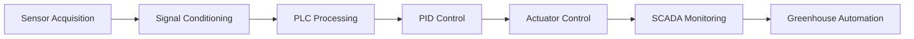
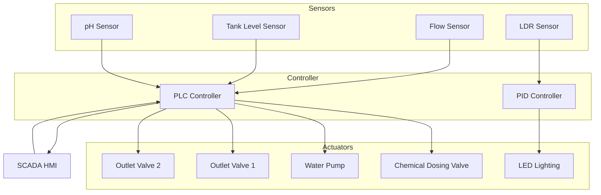
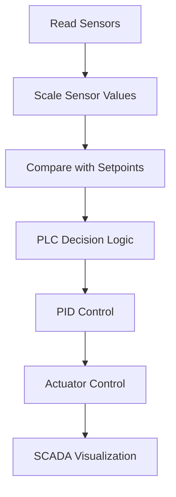
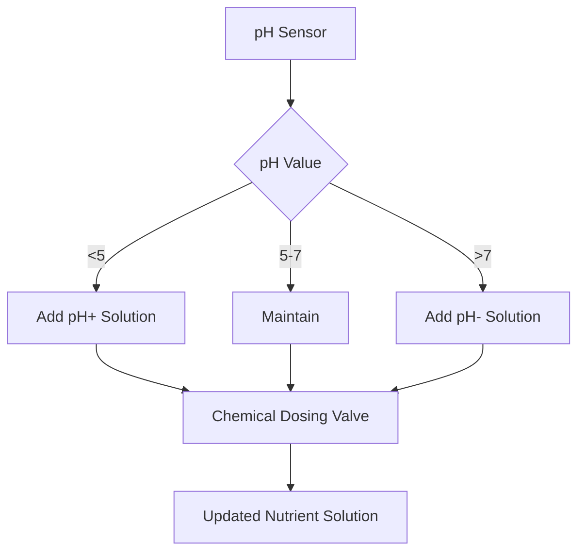
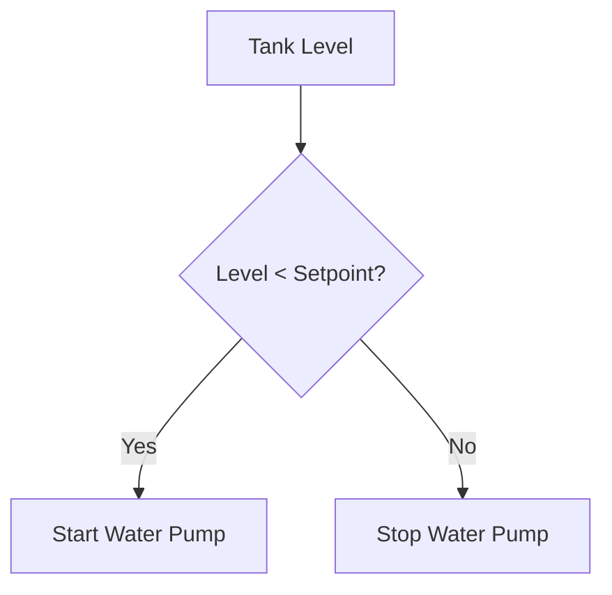
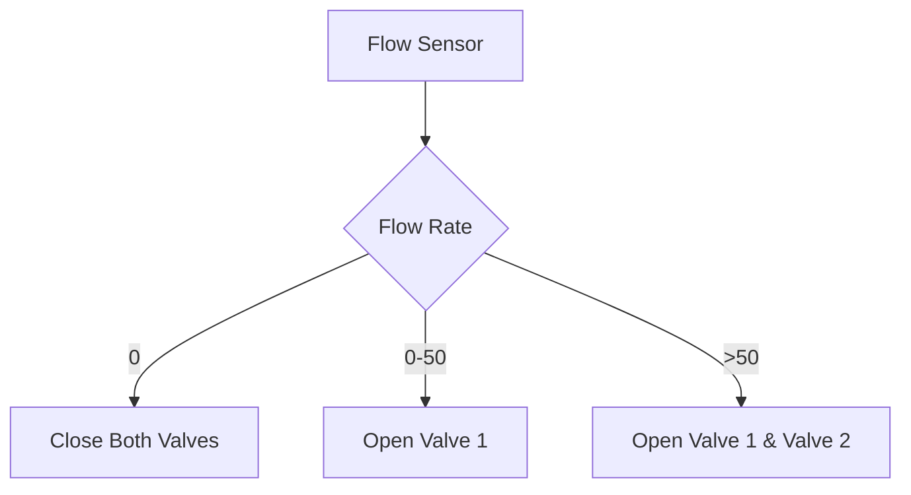
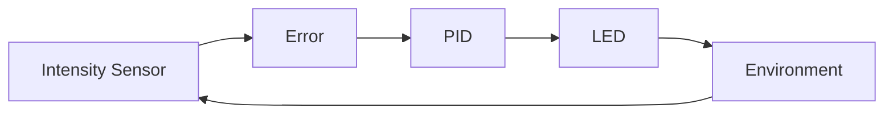
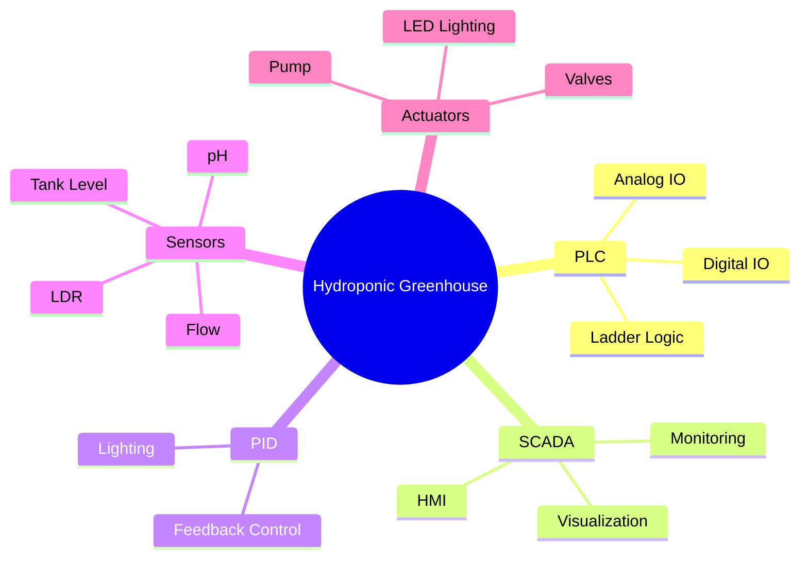

# Hydroponic Greenhouse Automation

> PLC, SCADA, and PID-based automation system for monitoring and controlling an indoor hydroponic greenhouse.

This project demonstrates the design and implementation of an automated hydroponic greenhouse capable of maintaining optimal environmental conditions through industrial automation techniques. The system integrates **PLC ladder logic**, **SCADA visualization**, and **PID control** to automate irrigation, nutrient dosing, pH regulation, tank level monitoring, flow control, and greenhouse lighting. :contentReference[oaicite:2]{index=2} :contentReference[oaicite:3]{index=3}

---

# Overview

The automation system continuously monitors greenhouse parameters using multiple sensors and automatically controls pumps, valves, and lighting to maintain healthy plant growth.

The project consists of two major modules:

- PLC & SCADA based greenhouse automation
- PID based greenhouse lighting control

---

# Project Pipeline



---

# Features

- PLC-based Industrial Automation
- SCADA Monitoring Interface
- PID Light Intensity Control
- Automatic pH Regulation
- Tank Level Monitoring
- Flow Rate Monitoring
- Nutrient Dosing Automation
- Irrigation Control
- Water Pump Control
- Real-Time Visualization

---

# System Architecture



---

# Workflow



---

# PLC Control Logic

The PLC continuously monitors:

- pH Level
- Tank Level
- Flow Rate

Based on these values, it automatically controls:

- Chemical dosing valve
- pH increase solution
- pH decrease solution
- Water pump
- Outlet valves

Sensor values are first normalized and scaled before being processed by the PLC ladder logic. :contentReference[oaicite:4]{index=4}

---

# PID Lighting Control

The lighting controller maintains stable indoor illumination by comparing outdoor light intensity with a desired setpoint.

An LDR sensor continuously measures ambient light, while a PID controller adjusts LED brightness to compensate for changing conditions, ensuring consistent lighting for plant growth. :contentReference[oaicite:5]{index=5}

---

# Hardware

| Component | Purpose |
|-----------|---------|
| PLC | Main Controller |
| SCADA | Operator Interface |
| pH Sensor | Nutrient Monitoring |
| Tank Level Sensor | Water Level Measurement |
| Flow Sensor | Flow Monitoring |
| LDR Sensor | Light Measurement |
| Water Pump | Irrigation |
| Chemical Dosing Valve | Nutrient Supply |
| LED Lighting | Artificial Illumination |

---

# Software

| Technology | Purpose |
|------------|---------|
| Siemens TIA Portal | PLC Programming |
| Ladder Logic | Industrial Control |
| SCADA | Monitoring & Visualization |
| MATLAB | PID Simulation |
| Arduino IDE | PID Lighting Prototype |

---

# Control Strategy



---

# Tank Level Logic



---

# Flow Control Logic



---

# PID Control Loop



---

# Technologies Used



---

# Repository Structure

```text
hydroponic-greenhouse-automation/

│
├── README.md
├── docs/
│   ├── "Project Reports"
│
├── images/
│   ├── greenhouse.jpg
│   ├── hardware_setup.jpg
│   ├── circuit.jpg
│   ├── ladder_logic.png
│   ├── scada_dashboard.png
│   └── pid_results.png
│
└── reports/
```

---

# Project Gallery

## Greenhouse Concept


---

## Hardware Prototype


---

## Circuit Design


---

## PLC Ladder Logic


---

## SCADA Dashboard


---

## PID Response


---

# Skills Demonstrated

### Industrial Automation

- PLC Programming
- Ladder Logic
- Analog Signal Processing
- Digital I/O

### Process Control

- PID Controller Design
- Feedback Control Systems
- Closed Loop Automation

### SCADA

- HMI Design
- Real-Time Monitoring
- Industrial Visualization

### Sensors & Instrumentation

- pH Measurement
- Tank Level Monitoring
- Flow Measurement
- Light Intensity Measurement

### Automation

- Irrigation Control
- Nutrient Dosing
- Water Management
- Greenhouse Automation

---

# Future Improvements

- IoT Remote Monitoring
- Cloud Dashboard
- MQTT Communication
- AI-Based Crop Optimization
- Predictive Maintenance
- Automatic Nutrient Scheduling
- Energy Optimization
- Mobile Application

---

# License

This repository is released under the MIT License.
